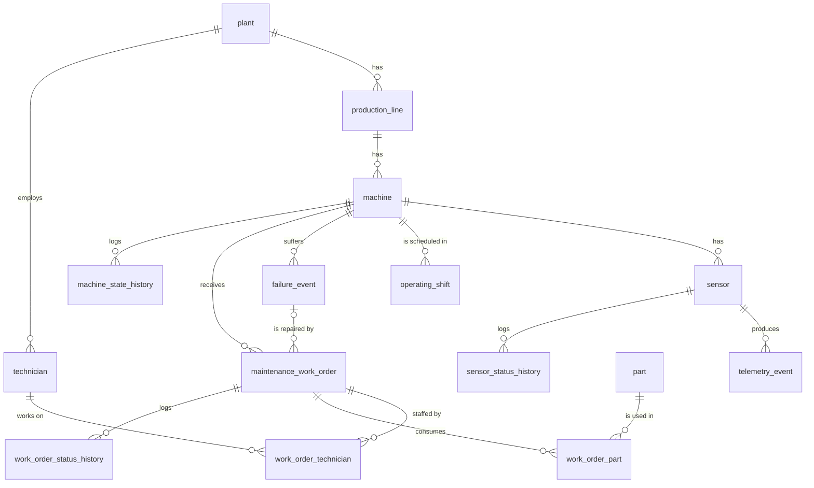

# Relationships

| Parent | Child | Cardinality | Notes |
|---|---|---|---|
| plant | production_line | 1 : N | |
| production_line | machine | 1 : N | |
| machine | sensor | 1 : N | |
| sensor | telemetry_event | 1 : N | Several readings per sensor; same-second duplicates get an ID suffix. |
| plant | technician | 1 : N | Technician's home plant. A technician may still be assigned to any work order. |
| machine | operating_shift | 1 : N | One planned shift record per machine per shift start. |
| machine | failure_event | 1 : N | |
| machine | maintenance_work_order | 1 : N | |
| failure_event | maintenance_work_order | 1 : N (optional) | `failure_id` is NULL for preventive/inspection work. |
| maintenance_work_order | technician | **N : M** | Bridge `work_order_technician`; at most one `LEAD` per order (partial unique index). |
| maintenance_work_order | part | **N : M** | Bridge `work_order_part`; one row per part per order, with a quantity. |
| machine | machine_state_history | 1 : N | Optionally linked to the causing work order or failure. |
| sensor | sensor_status_history | 1 : N | |
| maintenance_work_order | work_order_status_history | 1 : N | Optionally records which technician made the change. |
| technician | work_order_status_history | 1 : N (optional) | `changed_by_technician_id` |

**1 : 1 relationships:** none are needed in this model, so none exist. (The "lead technician" of a work order is
a 0..1 relationship per order, enforced by the partial unique index.)

**Deletion:** no `ON DELETE CASCADE` anywhere. PostgreSQL refuses to delete a parent that still has children, which
protects history. Master data is retired with a `status` value (e.g. `DECOMMISSIONED`, `RETIRED`), not deleted.
